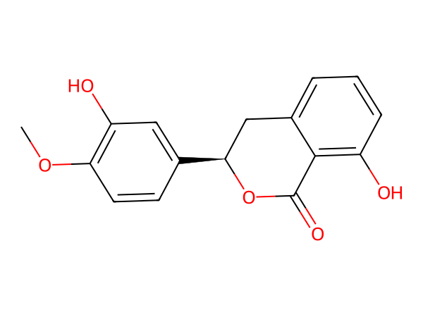
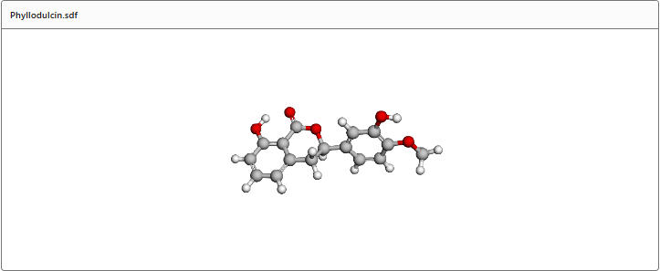
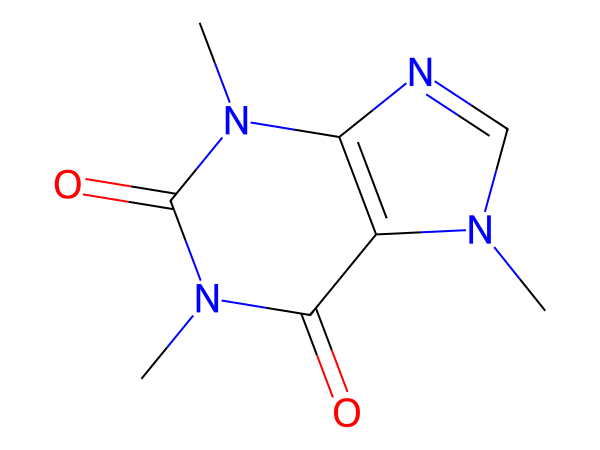
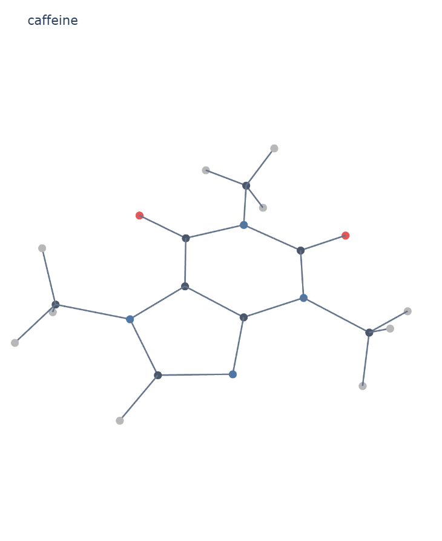
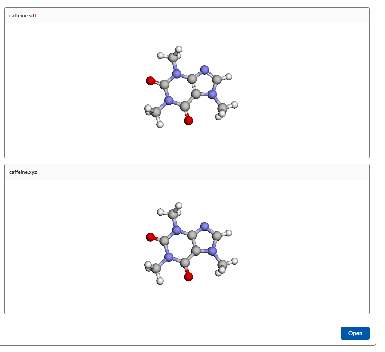
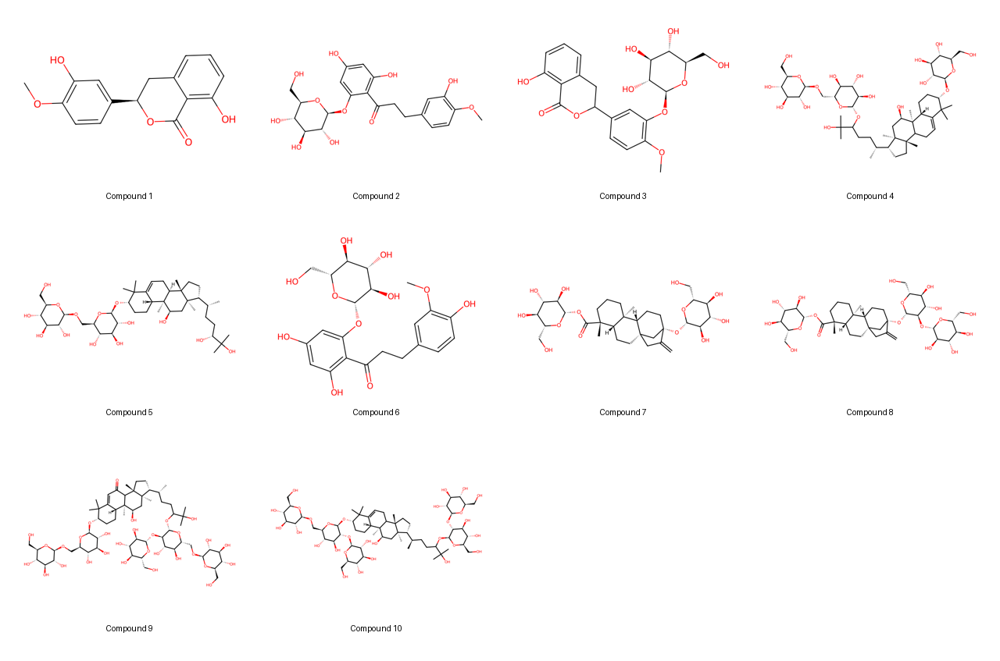

# Molecule Visualization Agent

## Overview

Creates 2D molecule images and optional interactive 3D conformer plots from
user-provided SMILES using RDKit and Plotly. The
[prompt agent](agent.yaml) invokes the
[molecule-visualizations tool](tools/molecule-visualization/tool.yaml) and
returns actual promoted artifacts rather than invented download links.
No model inference runs inside the tool container.

## Architecture

1. The prompt agent identifies the requested molecules and output formats.
2. Discovery renders SMILES and names into inline UTF-8 input files rather
   than interpolating them into command arguments.
3. The non-root CPU container generates images and optional optimized conformers.
4. Discovery promotes `/output`; the agent checks the result and shares actual
   artifact references, reporting any incomplete molecules.

## Prerequisites

- A Discovery workspace, compatible chat model, and permission to deploy agents
  and register tools.
- An Azure Container Registry accessible to the execution infrastructure.
- A CPU node pool satisfying the tool definition: minimum 2 vCPUs, 4 GiB RAM,
  and 16 GiB ephemeral storage. No GPU is required.
- Mounted output and scratch directories writable by UID/GID `10001:10001`.
  Mounted-volume permissions override image-directory ownership.

## Configuration

Replace `{{CHAT-MODEL}}` with the chat model deployment name and
`{{moleculeVisualizationsToolId}}` with the registered tool's ARM resource ID.
The image registry uses the deployer-substituted `{name}` placeholder.
Human-in-the-loop input and tool confirmation are enabled.

Build and register the tool before deploying the agent. See the
[tool README](tools/molecule-visualization/README.md) for build commands,
CLI examples, dependency pins, and output details.

## Usage

- "Visualize CCO as ethanol and return the 2D PNG and SVG."
- "Generate an interactive 3D conformer for aspirin using
  CC(=O)Oc1ccccc1C(=O)O, including its structure files."
- "Create a combined 2D contact sheet for CCO, CC(=O)O, and c1ccccc1,
  with two molecules per row."

Provide exact SMILES and optional molecule labels. For a table, identify the
SMILES column and selected rows. The agent preserves input order and reports
failed molecules explicitly.

## Example outputs

The following examples use the prompts sent to the agent in Discovery Studio.
PNG previews are included because Markdown does not render SDF, PDB, or XYZ
structure files, and the HTML preview is static; the generated HTML itself
remains interactive.

### Phyllodulcin from a CSV

**Prompt**

> Generate 2d and 3d images for all the molecules in the attached csv file.

2D image:

3D structure preview from the generated SDF:

### Caffeine

**Prompt**

> Generate the 2d and 3d visualizations for caffeine: CN1C=NC2=C1C(=O)N(C)C(=O)N2C

2D image:

HTML preview:

Studio previews of the generated SDF and XYZ structures:

### Molecule gallery

**Prompt**

> Generate visualization gallery for all the molecules in the attached csv

Combined 2D contact sheet:

## Tools

| Tool | Actions | Inputs |
| --- | --- | --- |
| [molecule-visualizations](tools/molecule-visualization/tool.yaml) | Single-molecule 2D/3D and 2D gallery | Exact SMILES, optional names, 3D flag, and gallery column count |

### Outputs

Single-molecule output includes PNG and SVG. Optional 3D output includes
interactive HTML with embedded Plotly JavaScript, SDF, PDB, and XYZ.
Gallery output includes per-molecule 2D files and a labeled contact sheet.
The HTML is self-contained and can be opened offline without companion files.

## Known Limitations

3D structures are computed conformers, not experimentally determined
structures. Invalid SMILES or conformer-generation failures must be reported.
The tool does not predict taste, biological activity, safety, or similarity.
Gallery success may be partial; inspect reported status and counts.
3D generation allows up to 2,000 MMFF optimization iterations. Unsupported
force fields and nonconvergence are explicit failures, not silently accepted
structures.

Container output paths are not download links. Discovery must promote outputs
before the agent can share them. Local container tests do not validate that
promotion or the deployed action-template behavior.
Interactive HTML requires JavaScript and WebGL. A Studio preview may restrict
those features; download the HTML and open it in a compatible browser if the
preview is blank. File generation alone does not prove that a preview can render.

## Publication status

Agent and tool definitions, Microsoft publisher metadata, and container sources
are present. Deployment and output promotion must be validated in the target
workspace. See the [authoring guide](../../docs/authoring-guides/agent-authoring-guide.md)
and [contribution workflow](../../CONTRIBUTING.md).
