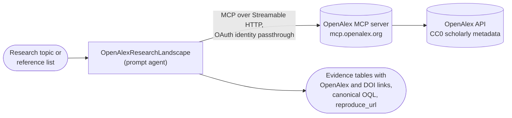

# OpenAlex Research Landscape

A research-landscape and citation-verification agent grounded in
[OpenAlex](https://openalex.org), the open catalog of the world's scholarly works, authors,
institutions, sources, topics, and funders. The agent reaches OpenAlex through the provider's
official, open-source [OpenAlex MCP server](https://github.com/ourresearch/openalex-mcp-server),
hosted by OurResearch at `https://mcp.openalex.org/mcp`. It does not ship its own MCP server or
container.

## Overview

**OpenAlexResearchLandscape** is the agent defined in this folder's `agent.yaml`. It maps a
research area rather than summarizing papers. For a topic, it builds and previews a reproducible
OpenAlex query, then reports how the field is changing over time, who publishes in it, and which
works anchor it. Every row in its tables comes from an OpenAlex tool result and links back to
OpenAlex, with DOI links when OpenAlex returns them.

It works in three modes:

| Mode | When it applies | What you get |
| --- | --- | --- |
| **Landscape** | Map a topic: volume, trend, leading authors, institutions, venues, and key works | A direct answer, then key works, trend, and contributor tables, plus query provenance and caveats |
| **Verification** | Check that references exist and fill in identifiers | A per-reference table of matched, uncertain, or not found, with DOI and OpenAlex links |
| **Follow-up** | A question that builds on results already in the conversation | A short reply grounded in the retrieved records, with at most one targeted call |

Its OpenAlex access is read-only. Instructions forbid account, author-profile, curation,
expert-finding, and alert tools, and the allowlist in [`mcp/README.md`](mcp/README.md) does not expose
them. Saving a finished report can write an asset to the Discovery workspace; it does not change
OpenAlex.

## Architecture

`OpenAlexResearchLandscape` is a prompt agent with no containerized tools and no custom compute. It
calls read-only tools on the hosted OpenAlex MCP server through a remote MCP connection in the
Microsoft Foundry project behind the Discovery workspace. It also uses Discovery's built-in resource
tools to save a finished landscape as a workspace asset.



The hosted OpenAlex MCP server accepts only OAuth. Each user signs in to OpenAlex once per Foundry
connection, and every call spends that user's own OpenAlex budget. The server has no shared key and
does not pass API-key headers through, so a key-based connection like the one other catalog MCP
agents use does not work here.

| Tool group | Tools the agent may use |
| --- | --- |
| Search and retrieval | `search_works`, `get_work`, `list_citations`, `search_entities`, `get_entity` |
| Counts and profiles | `group_works`, `analyze_works`, `check_oql`, `calculate_works` |
| High-recall search | `find_keywords`, `keyword_search` |
| Verification and help | `resolve_references`, `read_docs` |

## Prerequisites

- A Microsoft Discovery workspace and project, with a chat model deployment that supports tool
  calling available to the project.
- **A free OpenAlex account for every person who uses the agent.** Sign up at
  [openalex.org/signup](https://openalex.org/signup). No paid plan is needed. See
  [Cost, data, and privacy](#cost-data-and-privacy) for the free budget.
- **To create the connection:** permission to add a tool in the Foundry project behind the Discovery
  workspace, such as the **Foundry Project Manager** role.
- **To use the agent:** at least the **Foundry Agent Consumer** role on that project. OAuth identity
  passthrough requires that the user's Microsoft Entra tenant matches the project's tenant.
- PowerShell 7+ and Azure CLI for the verified API setup and validation walkthrough.
- Network access to the backing Foundry project's data-plane endpoint as well as Discovery.
  Successful Azure resource provisioning alone does not establish this access.

## Configuration

`agent.yaml` uses the `{{CHAT-MODEL}}` placeholder for the model deployment. Supply your own
deployment name at deploy time.

Deploy the agent to your project, or create it in Discovery Studio from `agent.yaml`, and **save** it
before you connect the tool. The *Open in Foundry* button appears only on a saved agent.

The catalog definition has no container-tool bindings (`discoveryExtensions.tools: []`). OpenAlex
needs a per-project remote MCP connection and an agent-version binding, neither of which catalog
deployment provisions. Configure them after deploying the agent:

| Setting | Value |
| --- | --- |
| Name | `openalex` |
| Remote MCP Server endpoint | `https://mcp.openalex.org/mcp` |
| Authentication | OAuth identity passthrough, **custom OAuth** |
| Client ID and secret | From registering an OAuth client with OpenAlex, using the Foundry redirect URL |
| Auth URL | `https://mcp.openalex.org/authorize` |
| Token URL and Refresh URL | `https://mcp.openalex.org/oauth/token` |
| Scopes | `openalex:query offline_access` |
| Allowed tools | The 13 read-only tools listed in [Architecture](#architecture) |
| Approval | Auto-approve; only read-only tools are allowed |

**[`mcp/README.md`](mcp/README.md) is the API setup and validation walkthrough**, including OAuth client
registration, preserving Discovery's injected tools when attaching MCP, and consent continuation.
The OAuth client secret is stored in the Foundry connection, not in this catalog. Never put it in
an agent definition, a task description, or a repository.

See [`TEST_RESULTS.md`](TEST_RESULTS.md) for the tested environment, public test inputs, observed
results, reproduction commands, and remaining gaps. The API path was exercised; the Foundry UI
setup and Discovery Studio consent display were not.

## Usage

Address the agent in a Discovery Studio session:

```text
@OpenAlexResearchLandscape Map recent research on solid-state battery electrolytes since 2019:
the relevant works, the leading authors and institutions, and the publication trend by year.
```

The first tool request can return an OpenAlex OAuth consent request instead of research output.
Open its sign-in link, approve access with your OpenAlex account, then continue the conversation.
The verified API continuation is described in [`mcp/README.md`](mcp/README.md#5-consent-and-validation).
Discovery Studio's display of the consent link remains unverified.

Follow up conversationally:

```text
Which of those institutions has grown fastest since 2022?
Show me the most-cited sulfide electrolyte papers in that set.
What cites the top paper?
```

Ask it to verify a bibliography:

```text
@OpenAlexResearchLandscape Are these references real? Give me DOIs and OpenAlex links.
1. Kamaya N. et al. A lithium superionic conductor. Nature Materials, 2011.
2. Janek J., Zeier W. G. A solid future for battery development. Nature Energy, 2016.
```

Every landscape ends with the canonical OQL and a `reproduce_url`, so you can rerun the exact query on
openalex.org or through the OpenAlex API.

## Cost, data, and privacy

- **Data license.** OpenAlex data is [CC0](https://creativecommons.org/publicdomain/zero/1.0/). The
  OpenAlex MCP server is MIT-licensed.
- **Budget.** Each call spends the signed-in user's OpenAlex budget. A free account has $1 of usage
  per day, reset at midnight UTC. Relevance-reranked searches cost twice a plain search. A new account
  spends its first $1 more slowly because of a short-window spending cap. When the daily budget runs
  out, single-record lookups keep working and other calls fail until the reset. See
  [OpenAlex pricing and authentication](https://help.openalex.org/access/connector/) for current
  terms.
- **Organization accounts.** If the person who connects is an OpenAlex organization owner, calls use
  the organization's key and budget.
- **What leaves your project.** Tool arguments, including search text and the references you ask it to
  verify, are sent to OpenAlex. Don't put confidential project details in queries. Review the
  [OpenAlex privacy policy](https://openalex.org/privacy) before use.

## Known Limitations

- **The connection is not created by catalog deployment.** Deploying `agent.yaml` creates the agent
  only. Each project needs its own Foundry connection and OAuth client registration.
- **Runtime validation is limited to one user.** On 2026-11-12, user-completed OAuth
  consent and actual `get_work`, `resolve_references`, `search_works`, and `analyze_works` calls were
  verified through the Discovery GA Responses API. The small keyword landscape required explicit
  query and parameter corrections. A new conversation reused that user's grant without another
  consent request, and a fabricated reference was reported not found. A later request required
  consent again; after authorization, an actual DOI tool call succeeded and the user confirmed a
  successful Engine chat lookup. Automatic refresh is not established. Discovery Studio's
  consent-link display, unattended Discovery Engine tasks, second-user authorization, token refresh,
  and saved landscape assets remain unverified. Complete consent interactively before attempting
  an unattended task.
- **Check the binding after redeployment.** An existing project connection does not prove that the
  latest agent version still has its MCP binding. Recheck the endpoint, connection ID, allowlist,
  and approval setting after saving or redeploying an agent.
- **The OAuth client registration expires.** The OpenAlex server keeps dynamically registered OAuth
  clients for 90 days. After that, the connection fails with an authentication error until you
  register a new client and update the connection. Expect users to sign in again. Access tokens last
  one hour and refresh tokens last 90 days.
- **Rotating an OpenAlex API key revokes the MCP grant.** The user then signs in again.
- **Metadata, not full text.** OpenAlex returns titles, truncated abstracts, metadata, and citation
  links. The agent does not read papers in full.
- **No bulk export or citation totals.** The tools answer questions and count works; they don't
  download whole result sets or total the citations across a set. Use the OpenAlex website, CLI, or
  snapshot for those.
- **Bibliometric caveats apply.** Author and institution disambiguation can be wrong, coverage varies
  by field and year, and citation counts change over time. The agent reports these caveats rather than
  correcting for them.
- **Semantic search is partial.** Semantic-mode searches and their aggregates cover at most the 50
  most relevant works, so the agent uses keyword mode for counts and trends.
- **No visualization.** The agent returns Markdown tables, not charts or dashboards.
- **The tool list can change.** The provider controls which tools the server exposes. The allowed-tools
  setting limits the agent to the read-only tools in this README, and new tools stay unavailable until
  you add them.

## Support

For questions about OpenAlex data, accounts, budgets, or the MCP server, see the
[OpenAlex help center](https://help.openalex.org) or contact `support@openalex.org`. Report MCP server
issues in the [openalex-mcp-server repository](https://github.com/ourresearch/openalex-mcp-server).

For issues with this catalog entry, open a discussion in the
[Microsoft Discovery community](https://techcommunity.microsoft.com/category/azure/discussions/microsoft-discovery-discussions).

## Contributing

Improvements to this agent definition are welcome. Read
[CONTRIBUTING.md](../../CONTRIBUTING.md) in the repository root for the catalog's submission flow,
schema requirements, and PR checks.
