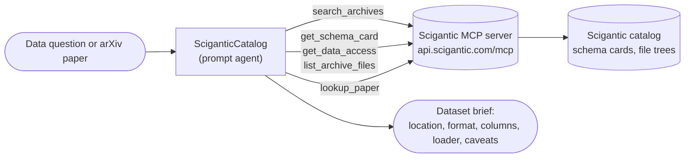

# Scigantic Catalog

A research data librarian for public scientific datasets. `SciganticCatalog` searches the
[Scigantic](https://scigantic.com) catalog of several thousand curated open archives, returns each
archive's schema card (format, columns, sample rows, data dictionaries, caveats) and a copy-paste
loader for the user's own environment, and links arXiv papers to the datasets behind them. It reads
the catalog through the public [Scigantic MCP server](https://github.com/Scigantic/scigantic-mcp),
which needs no API key.

## Overview

Finding a public dataset normally means a web search, a registry page, a bucket listing and a
download before you know whether the columns you need are there. This agent answers those
questions from the catalog's schema cards first.

Ask it for data on a topic and it searches the catalog, discards archives whose storage was probed
and found unreadable, checks the schema cards of the best candidates, and recommends one with its
storage location, format, key columns and a loader snippet. Ask it about a paper and it finds the
datasets the paper used or suggests. Ask it what a dataset looks like and it answers from the
schema card.

The catalog spans genomics and transcriptomics, medical and microscopy imaging, cryo-EM and
structural biology, chemistry and ADMET, neuroscience, ecology, earth observation, weather and
climate, and materials. Every archive is read-only public data on S3, GCS, Hugging Face, Zenodo
or plain HTTP. The same MCP server also exposes SureChEMBL patent chemistry tools, which the agent
uses when asked about patents.

Intended users: computational biologists, chemists, data scientists and anyone who needs to locate
and understand a public dataset before committing compute to it. A successful outcome is a dataset
brief the user can act on: where the data is, what is in it, how to load it, and what to watch out
for.

## Architecture

`SciganticCatalog` is a prompt agent with no containerized tools. It calls the remote Scigantic MCP
server over HTTP and uses Discovery's built-in resource tools to persist a finished dataset brief.



The MCP server is anonymous and read-only. It exposes these catalog tools:

| Tool | What it returns |
| --- | --- |
| `search_archives(query, category?, limit?)` | Ranked archives with id, title, category, summary, `probeStatus` and `objectCountEstimate` |
| `get_archive(id)` | Full metadata for one archive, including its schema card |
| `get_schema_card(id)` | File format, columns, sample rows or headers, inlined READMEs and data dictionaries, caveats, starter cell |
| `get_data_access(id, language?)` | Storage location plus loader snippets for the user's own environment |
| `list_archive_files(id, limit?)` | A sample of the files or objects in the archive |
| `get_sample_notebook(id)` | Cell-by-cell source of a worked starter notebook, when one exists |
| `lookup_paper(query)` | An arXiv paper by id or title, with linked catalog archives |

Six `surechembl_*` tools cover patent chemistry (compound lookup, patents for a compound, patent
text and extracted structures, Solr patent search, structure search). The `search` and `fetch`
tools are reduced aliases kept for ChatGPT connectors, and `list_compute_tiers` describes
Scigantic's own hosted notebooks; the agent is instructed to ignore all three.

The agent does not read the data. It returns the storage location and a loader snippet, and the
data is read wherever the user runs that snippet.

## Prerequisites

- A Microsoft Discovery workspace and project, with a chat model deployment available to the
  project. The agent is written for a reasoning model, so `agent.yaml` sets no model `options`.
- Permission to add a tool in the Microsoft Foundry project behind your Discovery workspace.
- Outbound HTTPS from the Foundry project to `api.scigantic.com`.

No Scigantic account, API key or subscription is needed. The MCP endpoint is public.

## Configuration

`agent.yaml` uses the `{{CHAT-MODEL}}` placeholder for the model deployment. Supply your own
deployment name at deploy time.

| Parameter | Description | Example |
| --- | --- | --- |
| `{{CHAT-MODEL}}` | Microsoft Foundry model deployment name | `gpt-5-deployment` |

The agent declares no `tools:` array. The Scigantic catalog is reached through a remote MCP
connection registered once per Foundry project and attached to the agent:

| Setting | Value |
| --- | --- |
| Name | `scigantic` |
| Remote MCP Server endpoint | `https://api.scigantic.com/mcp` |
| Authentication | None required. The endpoint is anonymous and read-only. |
| Approval | **Always auto-approve all tools** |

Approval must be set to auto-approve. The default asks for confirmation before every tool call,
and in an autonomous task run there is nobody to confirm, so the agent stalls.

[`mcp/README.md`](mcp/README.md) walks through the Foundry steps.

## Usage

Deploy the agent, connect the MCP tool as above, then address it in a Discovery Studio session:

```text
@SciganticCatalog I need single-cell RNA-seq of human cortex with cell-type annotations.
What public datasets fit, and how are they structured?
```

It searches, checks the schema cards of the best candidates, and answers with a recommendation,
a comparison table, the storage location, key columns and a loader snippet. Follow up
conversationally:

```text
Is there a mouse equivalent?
Show me a sample of the files.
What are the caveats in the data dictionary?
```

Start from a paper instead of a topic:

```text
@SciganticCatalog Which datasets does arXiv 2410.12345 use, and which are in the catalog?
```

Or ask about patent chemistry:

```text
@SciganticCatalog Who has patented compounds similar to this SMILES since 2022: CC(=O)Oc1ccccc1C(=O)O
```

Pair this agent with Discovery's `core-python-agent` or `stat-agent` to run the loader snippet and
begin analysis on the dataset it recommends.

## Known Limitations

- **No data retrieval.** The agent returns where the data is and how to load it. It does not
  download or read the data itself. Run the loader snippet in a code agent or your own
  environment.
- **Some archives are credentialed.** The catalog lists archives whose storage turned out to need
  credentials. These carry `probeStatus: empty` and the agent is instructed to skip them, but the
  flag comes from a periodic probe and can lag a change in the upstream bucket.
- **Search ranking is approximate.** Highly specific queries can rank a near-topic archive above
  the best one. The agent rewords the query and checks schema cards before recommending an archive.
- **Schema cards are sampled.** A card is built from a sample of files and rows, so a rare column
  or a format that appears only deep in the tree can be missing from it.
- **Paper lookup is arXiv only.** DOIs, PubMed ids and non-arXiv papers do not resolve.
- **No per-user state.** The endpoint is anonymous, so there are no saved searches or
  preferences across sessions.

## Support

For questions about the catalog, the MCP server or the data behind an archive, open an issue at
<https://github.com/Scigantic/scigantic-mcp/issues> or write to <aaron@scigantic.com>.

For issues with this catalog entry, open a discussion in the
[Microsoft Discovery repository](https://techcommunity.microsoft.com/category/azure/discussions/microsoft-discovery-discussions).

## Contributing

Improvements to this agent definition are welcome. Please read
[CONTRIBUTING.md](../../CONTRIBUTING.md) in the repository root for the catalog's submission flow,
schema requirements and PR checks.
